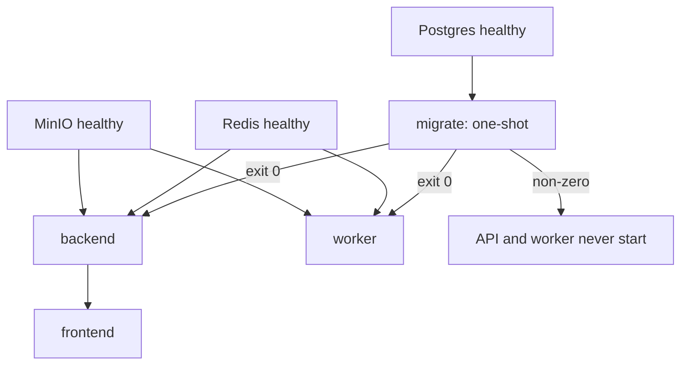
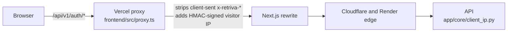
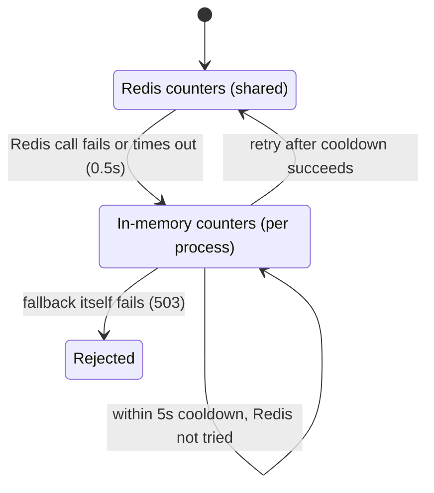

# Architecture

How Retriva is put together and how it behaves at startup and under failure.
For the data model and pipelines, see [docs/architecture.md](docs/architecture.md),
[docs/rag.md](docs/rag.md) and [docs/document-ingestion.md](docs/document-ingestion.md).

## Local and production differ

The same application code runs in both, with different supporting services.
Don't assume behaviour verified in one holds in the other.

| Concern | Local (Docker Compose) | Production |
|---|---|---|
| API | Container | Render free web service (one container, sleeps when idle) |
| Frontend | Next.js container, browser calls the API directly | Vercel, browser calls `/api/*` on Vercel, which proxies to Render |
| Document processing | **Celery worker** (`DOCUMENT_PROCESSING_MODE=celery`) | **Inside the API process, no worker** (`inline`) |
| Broker | Redis | None |
| Postgres | pgvector container | Neon |
| Object storage | MinIO | Neon S3-compatible storage |
| Rate-limit store | Redis | Render Key Value (shared with other projects, separate key prefixes) |
| Migrations | `migrate` service, automatic | Manual pre-deploy step, see [DEPLOYMENT.md](DEPLOYMENT.md) |
| Observability stack | Optional Compose profile | Not deployed |

## Startup

- **`scripts/migrate.py` is the only thing that runs migrations.** It waits for the
  database with a bounded retry, takes an advisory lock so concurrent runs queue
  instead of colliding, applies pending revisions, then verifies the result.
- **Exit codes:** `0` success, `1` migration failed, `2` refused because a pending
  migration destroys data and `--allow-destructive` wasn't passed, `3` database
  unreachable within `MIGRATE_DB_WAIT_SECONDS`.
- **The destructive check is a safety net, not a proof.** It reads each pending
  migration's `upgrade()` for table and column drops, `TRUNCATE` and `DELETE`. It
  can't see SQL built at runtime or a lossy `ALTER COLUMN TYPE`.
- **API replicas never migrate.** At startup the API only compares `alembic_version`
  with the revision its code expects, and refuses to start if the database is behind.
  A database *ahead* of the code is allowed, because that's the normal state just
  after rolling the app back.

## Rate limiting

### Which client is this?

Website traffic reaches the API from Vercel's addresses, so the TCP peer is the same
for every visitor. `resolve_client_ip` uses the first source that validates:

1. **Signed assertion** from our proxy, when `EDGE_PROXY_SHARED_SECRET` is set. The
   signature covers the timestamp and IP and expires after 60 seconds.
2. **`X-Real-IP`**, only if the TCP peer is listed in `TRUSTED_PROXY_IPS`.
3. **`TRUSTED_CLIENT_IP_HEADER`**, an opt-in for an edge that always overwrites that
   header. Off by default.
4. **The TCP peer.**

`X-Forwarded-For` is never read directly, because clients can add entries to it.
Anything invalid falls through to the next source, so a forged header gains nothing.
IPv6 addresses are reduced to their /64, since one subscriber normally controls a
whole /64.

### Which limit applies?

| Limit | Identity | Default per minute |
|---|---|---|
| Login | Client IP | 5 |
| Login | Hash of the submitted email | 10 |
| Register | Client IP | 3 |
| Refresh | Client IP | 20 |
| Chat | User | 20 |
| Upload | User | 10 |
| Retry, retrieval debug | User | 10, 20 |

Each route has its own counter, so exhausting login doesn't affect registration.
The per-account limit stops one account being guessed from many addresses. The
tradeoff is that someone who knows an email can briefly lock its login by
exhausting it, for up to a minute at a time.

### When Redis is unavailable

- A Redis failure never fails the request, and the same limits keep being enforced.
- **The fallback is per process, not global.** N API processes allow up to N times the
  limit. Counts aren't carried across a switch, so a client can briefly get up to
  twice its limit around one.
- Memory is bounded (`RATE_LIMIT_FALLBACK_MAX_KEYS`, 10,000 keys). At capacity it drops
  expired windows first, then the oldest, so a flood of distinct keys can cost those
  clients their counts but can't exhaust memory.
- Each transition logs once (`rate_limit_fallback_activated`, `..._deactivated`). The
  `rate_limit_fallback_active` gauge shows the current state.
- `/readiness` stays `200` during a Redis outage and lists `redis` under `degraded`.
  Failing it would let an orchestrator pull every instance and turn a Redis outage
  into a full one.

Redis being down still affects other things: in Celery mode, document uploads can't
reach the broker. That's addressed in phase R1.

## Known defects, not yet fixed

Reproduced and scheduled for later phases.

| Defect | Evidence | Phase |
|---|---|---|
| A document can stay in `PROCESSING` after a crash, broker data loss or (from reading the code) a production restart | Reproduced locally except the production case | R1 |
| Worker crashes don't count as attempts, so redelivery has no limit | Reproduced | R1 |
| A Postgres transaction stays open during file download and embedding calls | Reproduced | R1 |
| **Vector search returns fewer rows than requested.** With 683 chunks and one tenant, the normal query plan returned 7 of 20. The IVFFlat index is built on an empty table and scans one list by default. | [docs/benchmarks/R0.md](docs/benchmarks/R0.md) | R4 |
