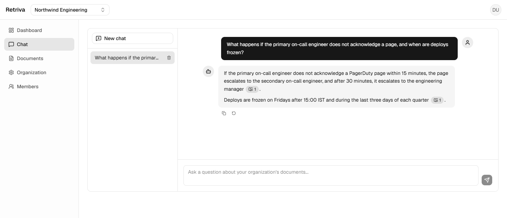
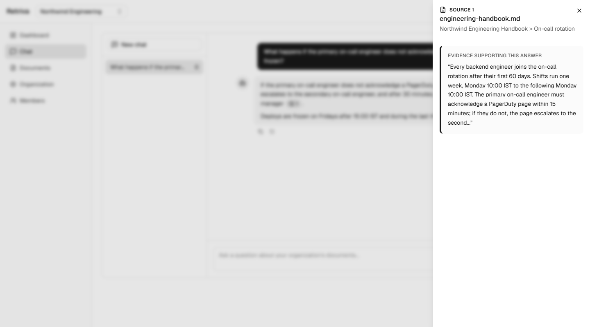
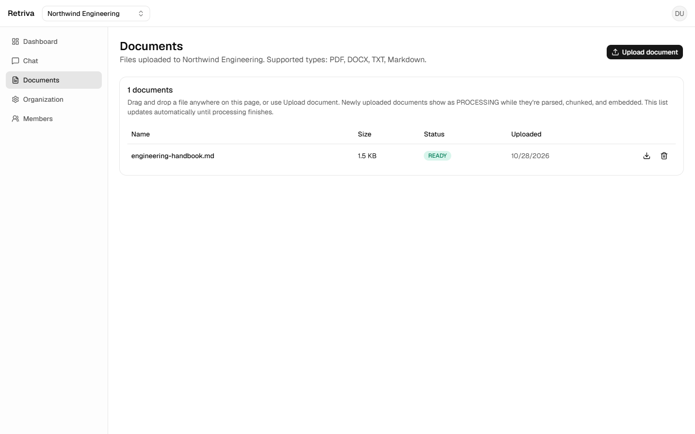
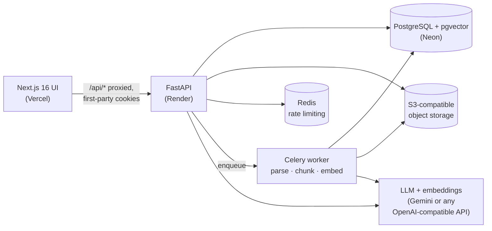
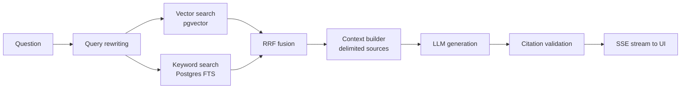

<div align="center">

# Retriva

**Multi-tenant AI knowledge platform: upload your organization's documents, ask questions, get grounded answers with verifiable citations.**

[](https://github.com/rohantiwari9573/retriva/actions/workflows/ci.yml)
[](LICENSE)


**[Live demo](https://retriva-nine.vercel.app)** · **[Architecture](docs/architecture.md)** · **[Security model](docs/security.md)** · **[RAG evaluation](docs/evaluation.md)**

</div>

<br />



<table>
<tr>
<td width="50%"><p align="center"><sub>Every citation opens the exact passage that supports the answer</sub></p></td>
<td width="50%"><p align="center"><sub>PDF, DOCX, TXT and Markdown are parsed, chunked and embedded asynchronously</sub></p></td>
</tr>
</table>

> The live demo runs on free-tier hosting. The first request after a period of inactivity can take up to a minute while the API wakes up. Registration is open, so you can create an account, upload a document and start asking questions.

---

## Highlights

- **Hybrid retrieval.** pgvector cosine similarity and PostgreSQL full-text search run side by side and are merged with Reciprocal Rank Fusion. Semantic matches and exact-term matches (error codes, product names, identifiers) both surface.
- **Grounded answers.** Responses stream token by token over SSE. Each `[SOURCE-n]` citation is checked against the retrieved content before it reaches the user, and unsupported citations are stripped.
- **Conversational follow-ups.** Follow-up questions are rewritten into standalone queries before retrieval. If the rewrite fails, the original question is used. Users can stop or regenerate an answer mid-stream.
- **Real multi-tenancy.** Organizations, memberships and `OWNER > ADMIN > MEMBER > VIEWER` RBAC are enforced server-side. A foreign organization returns `404`, never `403`, so its existence isn't leaked.
- **Hardened auth.** A short-lived JWT access token is paired with a rotating opaque refresh token, both in HTTP-only cookies. Replaying a revoked refresh token revokes every session for that user.
- **Defensive ingestion.** File types are validated from their bytes (magic numbers, ZIP structure), not their extension. Parsers have resource limits. Processing is idempotent, and failures are classified as transient or permanent.
- **Measured, not assumed.** An evaluation harness scores vector-only, keyword-only and hybrid retrieval separately (Recall@K, MRR, nDCG). It also runs LLM-as-judge generation scoring plus citation and prompt-injection checks.
- **Observable.** Structured JSON logs carry request-id and trace-id correlation. Prometheus metrics and OpenTelemetry traces propagate from the HTTP request into the Celery worker.

## Architecture



**How a question is answered**



Retrieved document text is confined to delimited context blocks, kept separate from the system instructions, as a prompt-injection defense. See [docs/rag.md](docs/rag.md) and [docs/retrieval.md](docs/retrieval.md) for the full pipeline.

## Tech stack

| Layer | Technology |
|---|---|
| Frontend | Next.js 16 (App Router), React 19, TypeScript, Tailwind CSS v4, TanStack Query |
| API | FastAPI, Pydantic v2, SQLAlchemy 2 (async), Alembic |
| Data | PostgreSQL + pgvector, PostgreSQL full-text search, Redis |
| Async processing | Celery (or in-process mode for single-container hosting) |
| Storage | S3-compatible object storage (MinIO locally), presigned downloads |
| AI | Gemini (`gemini-embedding-001`, Gemini Flash) or any OpenAI-compatible endpoint, e.g. LM Studio locally |
| Observability | structlog, Prometheus, Grafana, OpenTelemetry, Jaeger |
| Quality | pytest (~400 backend tests), Vitest + Playwright, Ruff, mypy, ESLint |
| Delivery | Docker Compose, GitHub Actions, Vercel, Render, Neon |

## Getting started

**Prerequisites:** Docker Desktop. To run the backend outside Docker you also need Python 3.12+ and Node 22+.

```bash
git clone https://github.com/rohantiwari9573/retriva.git
cd retriva
cp .env.example .env
docker compose up --build
```

| Service | URL |
|---|---|
| App | http://localhost:3000 |
| API + Swagger UI | http://localhost:8000/docs |
| MinIO console | http://localhost:9001 |

**Choosing a model provider.** By default `.env.example` points at a local [LM Studio](https://lmstudio.ai) server, so you pay nothing for API calls. Load an embedding model (e.g. `nomic-embed-text`) and a chat model (e.g. `qwen2.5-7b-instruct`). To use Google Gemini's free tier instead, uncomment the Gemini block in `.env.example` and add your key. [docs/gemini-provider.md](docs/gemini-provider.md) covers both setups.

**Observability stack (optional):**

```bash
docker compose --profile observability up --build
# Prometheus :9090 · Grafana :3001 · Jaeger :16686
```

**Common tasks** are wrapped in the `Makefile`: `make up`, `make test`, `make lint`, `make migrate`.

## Testing

```bash
cd backend && pytest            # unit + integration tests against real Postgres/pgvector
cd frontend && npm test         # Vitest
cd frontend && npm run test:e2e # Playwright critical flows
```

On every push and PR, CI runs Ruff, mypy, the pytest suite against a pgvector Postgres service, ESLint, a production `next build` and both Docker image builds.

## Evaluation

The harness in `backend/app/evaluation` reuses the production retriever and RAG classes, so it measures exactly what runs in the app. It ships with a versioned 35-case dataset covering 10 categories, including unanswerable questions and prompt-injection attempts.

In the recorded baseline, hybrid RRF beat both single strategies on every retrieval metric (Recall@10 **25.7%**, compared with 11.4% vector-only and 17.1% keyword-only). That run used a small local embedding model on CPU, and the methodology, per-case analysis and threshold tuning are written up in [docs/evaluation-baseline.md](docs/evaluation-baseline.md).

## Deployment

| Component | Host |
|---|---|
| Frontend | Vercel. `/api/*` is rewritten to the API, so auth cookies stay first-party |
| API | Render (Docker), with documents processed in-process (`DOCUMENT_PROCESSING_MODE=inline`) |
| Database | Neon PostgreSQL with pgvector |
| Object storage | Neon S3-compatible object storage |
| Rate limiting | Render Key Value (Redis-compatible) |
| Models | Google Gemini free tier |

In production the app refuses to start with insecure settings, such as non-`Secure` cookies or a wildcard CORS origin. Interactive API docs are disabled there and available locally. The project originally ran on a single AWS EC2 instance; that setup is documented in [docs/archive/aws-deployment.md](docs/archive/aws-deployment.md).

## Project structure

```text
backend/app/
  api/v1/        thin route handlers (auth, organizations, documents, chat)
  services/      business logic
  repositories/  org-scoped database access
  rag/           embedding + LLM providers, query rewriting, retrieval, prompts, citations, SSE
  ingestion/     parsers, normalization, chunking, pipeline
  evaluation/    RAG evaluation harness and CLI
  workers/       Celery tasks
  storage/       S3 / MinIO / in-memory storage providers
frontend/src/
  app/           Next.js routes (marketing, auth, authenticated app shell)
  components/    UI, documents, chat, organizations
  hooks/         TanStack Query hooks + SSE chat stream
docs/            architecture, RAG, retrieval, security, observability, evaluation
```

## Documentation

| Topic | Doc |
|---|---|
| System overview and data model | [architecture.md](docs/architecture.md) · [system-design.md](docs/system-design.md) |
| RAG pipeline and retrieval | [rag.md](docs/rag.md) · [retrieval.md](docs/retrieval.md) · [streaming.md](docs/streaming.md) |
| Document ingestion | [document-ingestion.md](docs/document-ingestion.md) |
| Security and threat model | [security.md](docs/security.md) |
| Observability | [observability.md](docs/observability.md) |
| Evaluation | [evaluation.md](docs/evaluation.md) · [evaluation-baseline.md](docs/evaluation-baseline.md) |
| Model providers | [gemini-provider.md](docs/gemini-provider.md) |
| Frontend and performance | [frontend.md](docs/frontend.md) · [performance.md](docs/performance.md) |

## Known limitations

- Members must already have an account to be added to an organization. There are no email invites or password reset, because no mail service is configured.
- Scanned PDFs without a text layer can't be processed, since there is no OCR.
- Every member of an organization can see all of its documents. There are no per-document ACLs.
- Rate limiting uses a fixed window on a single Redis instance.
- Some internal identifiers (cookie names, Compose project, Celery app name) still use the project's original working name, `nexus`. Renaming them would invalidate live sessions.

## License

[MIT](LICENSE) © 2026 Rohan Tiwari
