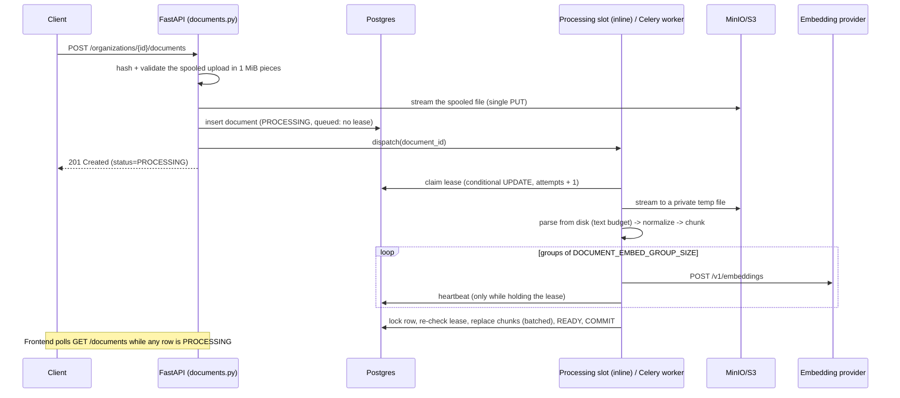
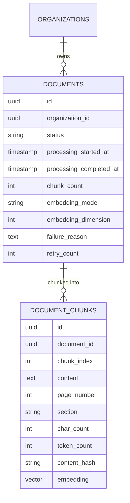

# Document Ingestion Pipeline (Phase 4)

How an uploaded document goes from `PROCESSING` to `READY`: parsing,
normalization, chunking, embedding, and storage in pgvector. This is the
first phase to run real background work (Celery) and the first to write
anything to `document_chunks`.

## Pipeline overview



No transaction stays open across the download, parsing or embedding calls, and
the finishing transaction is all-or-nothing: a failure (or a crash) before it
commits leaves no partial chunks. Every write a worker makes is conditional on
still holding the document's lease, so a stale or duplicate worker writes
nothing. See [Memory budget](#memory-budget) and
[Concurrency, leases and recovery](#concurrency-leases-and-recovery).

## Memory budget

The API (inline mode) runs on a 512 MB instance, so ingestion is built to keep
one document's memory bounded however large or pathological the file is, and to
bound how many documents are processed at once.

**Per document:**
- Uploads are hashed and validated in 1 MiB pieces from Starlette's spooled temp
  file and streamed to storage from it (one PUT; deliberately not boto3's
  multi-threaded transfer manager). The file is never held in memory whole.
- Processing streams the stored object to a private temp directory (removed on
  success and failure; leftovers from killed processes are removed at startup and
  on every sweep) and parsers read from disk: pypdf reads objects on demand; DOCX
  is read with `lxml.iterparse`, freeing each paragraph (output identical to
  python-docx); TXT/Markdown are decoded in blocks and consumed line by line.
- Every parser charges a text budget and stops as soon as the document passes
  `MAX_DOCUMENT_TEXT_LENGTH`, instead of extracting everything first. pypdf's
  per-stream decompression limits are lowered to `PDF_MAX_DECOMPRESSED_STREAM_BYTES`
  (10 MB, from pypdf's 75 MB).
- Embeddings are kept as float32 (`array("f")`, ~3 KB per chunk instead of
  ~25 KB as a list of Python floats) and chunks are inserted with batched Core
  INSERTs of `DOCUMENT_INSERT_BATCH_SIZE` rows, not thousands of ORM objects.

**Per process:** inline mode runs at most `DOCUMENT_PROCESSING_CONCURRENCY`
documents at once (default 1) on a dedicated executor; others wait in memory,
queued, and retry backoff is slept with no slot held. In Celery mode the worker's
own `--concurrency` bounds it.

**Measured** (API container capped at 512 MB, no swap; cgroup `memory.peak`):

| Scenario | Before | After |
|---|---|---|
| Five 25 MiB PDFs uploaded at once | 461 MiB | 272 MiB |
| Five large failed PDFs retried at once | OOM-killed | 274 MiB, all READY |
| Five 3.8 MB text-heavy PDFs (1,950 chunks each) | OOM-killed | 188 MiB, all READY |
| One text-heavy PDF | OOM-killed (chunker loop) | 174 MiB, READY |
| 25 MB Markdown of one-character lines | 420 MiB | 204 MiB, rejected early |
| 390 KB DOCX holding 95 MB of XML | 433 MiB | 171 MiB, rejected early |
| 0.8 MB PDF decompression bomb | 263 MiB | 172 MiB, rejected |

With `DOCUMENT_PROCESSING_CONCURRENCY=2` the same scenarios peaked at
223-292 MB and five text-heavy PDFs finished in 40 s instead of 54 s. 1 is the
default for a 512 MB instance (margin over the provider's own baseline); 2 is a
reasonable setting for 1 GB or more.

## Why Celery tasks can't use FastAPI's dependency injection

Storage (`StorageProvider`) and embeddings (`EmbeddingProvider`) are both
constructed via plain factory functions (`get_storage_provider()`,
`get_embedding_provider()`) rather than FastAPI `Depends()`. A Celery task
has no request/response cycle and no DI container - it's a synchronous
Python function that Celery calls directly - so the pipeline's core logic
(`app/ingestion/pipeline.py::process_document_pipeline`) takes storage,
embedding provider, and a session factory as **explicit parameters**. This
also makes it trivially testable: unit/integration tests pass in fakes
without any FastAPI machinery at all.

## Docker + Windows networking for LM Studio

FastAPI and Celery run inside Docker containers; LM Studio runs on the
Windows host. Inside a container, `localhost` refers to the container
itself, not the host machine - the same problem this project already solved
for a native Postgres install competing for port 5432 (see the main
README). The fix is `host.docker.internal`, which Docker Desktop resolves
to the host's IP from inside any container:

```
EMBEDDING_BASE_URL=http://host.docker.internal:1234/v1
LLM_BASE_URL=http://host.docker.internal:1234/v1
```

**To make LM Studio reachable from Docker:** in LM Studio's local server
settings, make sure it's *not* bound to `127.0.0.1` only - it needs to
listen on `0.0.0.0` (or at least accept connections from the Docker bridge
network) for `host.docker.internal` to reach it. Load an actual embedding
model (e.g. `nomic-embed-text`), not a chat model - see
[Embeddings](#embeddings) for why that distinction matters.

## Parsing

`app/ingestion/parsers/` defines a small `DocumentParser` protocol:

```python
class DocumentParser(Protocol):
    def parse(self, data: bytes) -> ParsedDocument: ...
```

`ParsedDocument` is a flat list of `ParsedElement(text, page_number,
section)`. An "element" is the smallest unit a parser can attach metadata
to:

| Format   | Element granularity        | Metadata captured                         |
|----------|-----------------------------|--------------------------------------------|
| PDF      | one element per page        | `page_number` (1-indexed)                  |
| DOCX     | one element per paragraph   | `section` = nearest preceding Heading-style paragraph |
| TXT      | whole file as one element   | none (no structure to preserve)            |
| Markdown | text between headings       | `section` = full heading path (`H1 > H2 > H3`) |

Parsing is intentionally synchronous (not `async def`) - Celery bridges into
asyncio once per task via `asyncio.run()`, and nothing else runs
concurrently on that loop, so a brief CPU-bound parse doesn't starve
anything the way it would inside a FastAPI request handler serving many
concurrent requests.

Markdown headings are parsed with a plain regex (`^#{1,6}\s+`) rather than a
full Markdown-to-AST library (mistune, markdown-it-py): ATX heading syntax
is simple and stable, and rendering the whole document to HTML just to
re-extract plain text would be more moving parts for the same result.

Parser failures raise `ParsingError` (a `PermanentProcessingError` - see
[Retry behavior](#retry-behavior)): a corrupt PDF or password-protected file
will never parse successfully no matter how many times it's retried.

## Text normalization

`app/ingestion/normalization.py::normalize_text` runs on every paragraph
before chunking. It is deliberately conservative - it exists to fix
extraction *artifacts*, not to rewrite content:

- Strips control characters (`\x00`-`\x1f` except `\t\n\r`) - Postgres
  rejects `\x00` in text columns outright, and no font encodes meaning in a
  control byte.
- NFKC Unicode normalization - folds compatibility characters (e.g. a
  non-breaking space) to their canonical form so text compares/embeds
  consistently regardless of source encoding quirks.
- Normalizes line endings to `\n`.
- Collapses 3+ blank lines to 2, and repeated spaces/tabs to one -
  extraction artifacts, not content.

It never lowercases, strips punctuation, or removes stopwords - any of that
would permanently discard information from the stored chunk. If needed at
all, that kind of normalization belongs at retrieval/query time (Phase 5),
not here.

## Chunking

`app/ingestion/chunking.py::chunk_document` is structure-aware, not naive
fixed-N-character splitting:

1. Each parsed element's text is normalized, then split into paragraphs
   (`\n\n`-separated).
2. A paragraph larger than the target chunk size is itself split - first on
   sentence boundaries (keeps sentences intact); if that produces no
   boundaries (one giant run-on sentence), on a fixed character window
   instead.
3. Paragraphs are packed greedily into chunks up to `CHUNK_SIZE_TOKENS`.
   A chunk's `page_number`/`section` come from its **first** paragraph.
4. Overlap is carried at paragraph granularity: after closing a chunk, the
   trailing paragraphs whose combined size fits within
   `CHUNK_OVERLAP_TOKENS` become the start of the next chunk. This avoids
   slicing the last N raw characters off a chunk, which can cut a sentence
   in half.

**Determinism**: `chunk_document` is a pure function of (parsed content,
`CHUNK_SIZE_TOKENS`, `CHUNK_OVERLAP_TOKENS`) - no randomness, no wall-clock
input - so re-running it on retry always reproduces identical chunks and
`content_hash` values.

**Token counting is an approximation** (~4 characters/token), not a real BPE
tokenizer like `tiktoken`. This is a deliberate trade-off: `tiktoken`
downloads its encoding tables over the network on first use, which would
give a project whose entire point is running at zero cost and fully offline
a hidden network dependency just to size chunks. `token_count` is stored per
chunk, so a more exact tokenizer can be swapped in later without a schema
change.

Each chunk stores: `chunk_index`, `content`, `page_number`, `section`,
`char_count`, `token_count`, `content_hash` (SHA-256 of `content`), and
`embedding`.

## Embeddings

`app/rag/embedding/base.py` defines the provider interface:

```python
class EmbeddingProvider(Protocol):
    dimensions: int
    model: str
    async def embed_documents(self, texts: list[str]) -> list[list[float]]: ...
    async def embed_query(self, text: str) -> list[float]: ...
```

`LMStudioEmbeddingProvider` (`app/rag/embedding/lmstudio.py`) implements
this against any OpenAI-compatible `/v1/embeddings` endpoint - LM Studio is
the zero-cost target, but the class works unmodified against any other
OpenAI-compatible server. It is configured entirely via environment
variables and never hardcodes a model name or dimension:

```
EMBEDDING_PROVIDER=openai_compatible
EMBEDDING_BASE_URL=http://host.docker.internal:1234/v1
EMBEDDING_API_KEY=not-needed-for-local
EMBEDDING_MODEL=nomic-embed-text
EMBEDDING_DIMENSIONS=768
EMBEDDING_BATCH_SIZE=32
EMBEDDING_REQUEST_TIMEOUT_SECONDS=30
```

A fresh `httpx.AsyncClient` is created per call rather than cached on the
instance - this provider runs both inside FastAPI (one event loop for the
process lifetime) and inside Celery tasks (a new event loop per task, via
`asyncio.run()`). Caching a client would bind its connection pool to
whichever loop first touched it, the same class of bug that once broke the
Redis-backed rate limiter in Phase 2.

**Dimension safety, two layers deep:**

1. Every batch response is checked: if a returned vector's length doesn't
   match `EMBEDDING_DIMENSIONS`, `EmbeddingDimensionMismatchError` is raised
   immediately - never silently truncated or padded. This catches "someone
   pointed `EMBEDDING_MODEL` at a chat model, or a model with a different
   output width, without updating `EMBEDDING_DIMENSIONS`."
2. Independently, `app/ingestion/schema_check.py` compares the *live*
   `document_chunks.embedding` column width (read via
   `format_type(atttypid, atttypmod)`, e.g. `vector(768)`) against
   `EMBEDDING_DIMENSIONS` - both at FastAPI startup (`app/main.py`'s
   lifespan) and at the start of every processing run. This catches the
   case the first check can't: `EMBEDDING_DIMENSIONS` and the model
   actually agree, but the *column* is still sized for a previous model.
   Both failures raise a message naming both numbers and what to do.

**Batching**: `embed_documents` sends `EMBEDDING_BATCH_SIZE` texts per HTTP
request, not one request per chunk. `MAX_CHUNKS_PER_DOCUMENT` (default
2000) bounds how much a single document can ever ask for in memory at once;
a document that would produce more chunks than that fails permanently
rather than silently truncating (truncating and marking the document
`READY` would mean part of it is unsearchable while the UI claims otherwise
- the same category of lie Phase 3 refused to tell with a fake `READY`
stub).

### Test-only provider

`app/rag/embedding/testing.py::DeterministicTestEmbeddingProvider` generates
deterministic vectors (same text -> same vector, correct configured width,
no network at all) for integration tests. It is **never** imported from
application code - only from tests. This keeps three test tiers genuinely
separate:

- **Unit tests** (`tests/unit/test_embedding_lmstudio.py`) mock the HTTP
  layer with `httpx.MockTransport` - no real network, tests the provider's
  own logic (batching, ordering, error mapping).
- **Integration tests** (`tests/integration/test_document_pipeline.py`,
  `test_document_processing_task.py`) run the real pipeline/task end to end
  against `DeterministicTestEmbeddingProvider` - proves the whole chain
  (parse -> chunk -> embed -> persist -> pgvector) actually works, without
  requiring LM Studio in CI.
- **E2E test** (`tests/e2e/test_lmstudio_e2e.py`) calls a real LM Studio
  instance and is skipped automatically if one isn't reachable - see that
  file for exactly what it checks and the Final Report for whether it
  actually ran in this environment.

## Database

`document_chunks` (migration `284636820202`):



- `document_chunks` has **no `organization_id` column**. Tenant isolation is
  inherited entirely through `document_id` - every chunk read goes through
  `DocumentChunkRepository`, which only ever takes a `document_id` a caller
  already fetched via `DocumentRepository.get_by_id_in_org` (the same
  membership-checked, 404-not-403 pattern every other org-scoped resource
  uses). There's deliberately no "get chunk by id alone" method, so there's
  no way to accidentally bypass the org check.
- `UniqueConstraint(document_id, chunk_index)` - the idempotency backstop:
  even if two workers somehow both process the same document concurrently
  (see [Concurrency](#concurrency-leases-and-recovery)), this constraint turns a
  silent duplicate into a loud `IntegrityError` instead.
- There's deliberately no vector index: search is exact (see `docs/retrieval.md`).
  The original `ivfflat` index on `embedding` with `vector_cosine_ops` supported
  approximate nearest-neighbor search for Phase 5's retrieval query.
- The `CREATE EXTENSION IF NOT EXISTS vector` statement is now part of this
  migration. Previously it was only ever run manually
  (`psql -c "CREATE EXTENSION ..."`) during local/CI setup - a real gap this
  phase closes, so `alembic upgrade head` alone provisions a fresh
  environment correctly.

**Migration downgrade note**: the extension is deliberately *not* dropped in
`downgrade()`. Unlike the Phase 2/3 native ENUM types (which this project's
migrations do drop explicitly, since Alembic autogenerate doesn't track
their lifecycle), dropping the `vector` extension would fail or cascade
depending on what else references it, and the test suite runs
`downgrade base` -> `upgrade head` every session - leaving the extension
installed makes that round-trip idempotent.

## Retry behavior

Every failure is classified as the pipeline runs (`app/ingestion/runner.py`):

```mermaid
flowchart TD
    A[attempt: claim, process] --> B{Outcome}
    B -->|TransientProcessingError,<br/>database connection error| C{Attempts left?}
    C -->|Yes| D[Release lease: queued again;<br/>retry after exponential backoff]
    C -->|No| E[FAILED: "failed after multiple attempts"]
    B -->|PermanentProcessingError<br/>ParsingError, EmptyDocumentError,<br/>TextLimitExceededError,<br/>MAX_CHUNKS exceeded| F[FAILED immediately]
    B -->|Unexpected exception| G[FAILED with a<br/>generic safe message]
    D --> A
```

- **Transient** (worth retrying): embedding provider unreachable or 5xx, a
  storage read failure, the database unreachable mid-attempt. Backoff is
  `DOCUMENT_PROCESSING_RETRY_BACKOFF_SECONDS * 2^(attempt-1)` (default 10 s,
  20 s, 40 s), for at most `DOCUMENT_PROCESSING_MAX_RETRIES + 1` attempts
  (default 4). Inline mode sleeps the backoff in the event loop without holding a
  processing slot (previously `Task.apply()` retried back to back with no
  backoff); Celery mode uses `self.retry(countdown=...)`.
- **Permanent** (never worth retrying): a corrupt/unparseable file, an empty
  document, too much extracted text, a dimension mismatch, exceeding
  `MAX_CHUNKS_PER_DOCUMENT`, or a storage object that's genuinely missing.
- **Attempts** are counted when a document is *claimed*, so an attempt that dies
  mid-way (OOM kill, restart, worker crash) still counts. A document that keeps
  killing its worker ends `FAILED` ("interrupted repeatedly") instead of being
  redelivered forever. A user retry resets the count.

## Failure handling and cleanup

A failed attempt has written nothing to the document's chunks: chunks are only
replaced in the final, all-or-nothing transaction. The outcome is recorded with
a short conditional UPDATE (FAILED, or released for retry) that only applies
while the attempt still holds the document's lease. If even that can't be
recorded (database down), the lease simply expires and the recovery sweep
re-queues the document.

`failure_reason` is always a safe, human-readable string chosen by the code
that raised the error (see `app/ingestion/errors.py`) - never a raw exception
message, stack trace, file path, or connection string fragment. An unexpected
error gets a generic "An unexpected error occurred" message and the real
exception goes only to the structured log.

If dispatching fails at upload time (e.g. the Celery broker is unreachable),
`DocumentService._enqueue_processing` flips the document straight to `FAILED`
with a retryable reason.

## Concurrency, leases and recovery

A `PROCESSING` document is either *queued* (`processing_token` NULL,
`processing_heartbeat_at` = when it was queued) or *claimed* (`processing_token`
= the worker's token, `processing_heartbeat_at` = its last heartbeat). See
`app/ingestion/lease.py`.

- **Claim** is one conditional UPDATE: it succeeds only for a queued document or
  one whose lease expired (`DOCUMENT_PROCESSING_LEASE_SECONDS`, default 600 s).
  A duplicate delivery (Celery `acks_late` redelivery, a sweep re-queue racing
  the original) finds the document held, READY, or FAILED and does nothing.
- **Finish** locks the row, re-checks the lease, deletes the document's old
  chunks and inserts the new ones, and marks READY in one transaction. A worker
  that lost its lease (expired and re-claimed) writes nothing.
- **Recovery sweep** (`app/ingestion/recovery.py`), run by the API at startup and
  every `DOCUMENT_PROCESSING_SWEEP_INTERVAL_SECONDS` (default 60 s): documents
  queued for longer than `DOCUMENT_PROCESSING_QUEUE_STALE_SECONDS` with no worker
  claiming them, claimed with no heartbeat for the lease period, or with no
  heartbeat at all (stranded before this mechanism existed) are re-queued and
  dispatched again, or failed when out of attempts. Each re-queue is a
  compare-and-set, so concurrent sweeps (several API instances) re-queue a
  document once. Nothing can stay `PROCESSING` indefinitely: worst case is the
  lease period plus one sweep interval.

Measured on the 512 MB stack: an API killed mid-processing, a Celery worker
killed mid-processing, Postgres stopped mid-processing and MinIO stopped while a
document waited for its download all ended with the document `READY` after
recovery, and seven documents stranded in `PROCESSING` by the old code were
recovered on first startup (six READY, one correctly FAILED for exceeding the
chunk limit).

## Security

- Uploaded files are never executed. Parsing uses `pypdf`/`python-docx`,
  which only read file structure - there's no code path that shells out to
  or interprets uploaded content as a program.
- The client-supplied filename is never trusted for anything beyond
  display - the storage key (and therefore what the parser reads) is
  derived entirely from the document's own UUID, exactly as established in
  Phase 3.
- The existing content-hash-based duplicate-upload rejection
  (`UniqueConstraint(organization_id, content_hash)`) is unchanged - this
  phase doesn't introduce a second, inconsistent duplicate-detection
  mechanism.
- A Celery task can only ever operate on the `document_id` it was given, and
  every DB query the pipeline issues is scoped to that document row - there
  is no code path by which processing one organization's document could
  read or write another's data.
- No internal exception text, file path, or secret is ever written to a
  field the API exposes (see [Failure handling](#failure-handling-and-cleanup)).

## API

`GET /organizations/{id}/documents/{document_id}` (unchanged route, extended
response) now returns processing metadata:

```json
{
  "status": "FAILED",
  "processing_started_at": "2026-09-12T09:04:48.087Z",
  "processing_completed_at": "2026-09-12T09:04:48.120Z",
  "chunk_count": 0,
  "embedding_model": null,
  "failure_reason": "Could not reach embedding backend at http://host.docker.internal:1234/v1. ...",
  "retry_count": 3
}
```

`POST /organizations/{id}/documents/{document_id}/retry` (new) re-queues a
`FAILED` document - MEMBER role or above, same as upload. Any other source
status is rejected (`409 INVALID_STATUS_TRANSITION`); this is not a general
"restart processing" button.

The upload endpoint's own behavior is unchanged in shape: it stores the file
and returns `PROCESSING` synchronously-but-fast, exactly as it did at the
end of Phase 3. It never parses, chunks, or embeds inline.

## Frontend

`/documents` polls `GET /documents` via TanStack Query's `refetchInterval`
whenever at least one row is `PROCESSING`, and stops polling once nothing is
(`refetchInterval` returning `false`). This is explicitly **not**
WebSockets, per the Phase 4 spec - that's a reasonable future upgrade, not
something this phase needed.

- `PROCESSING` shows a spinning indicator next to the badge - no fake
  progress percentage, since the pipeline doesn't report partial progress.
- `FAILED` shows the document's `failure_reason` inline and a retry button
  (role-gated the same as upload) that calls the new retry endpoint.
- `READY` behaves exactly as before (download/delete available).

## Known limitations

- A document that was queued in memory when an inline-mode API stopped is
  re-queued by the next process's startup sweep; one whose claim was still live
  waits for its lease to expire (default 600 s) plus one sweep interval.
- Embeddings are still requested in groups and held for the whole document
  (float32, ~3 KB per chunk) until the final transaction, so memory per document
  grows with its chunk count, which `MAX_CHUNKS_PER_DOCUMENT` bounds.
- Token counts are an approximation (~4 chars/token), not an exact
  tokenizer count - see [Chunking](#chunking) for why.
- No OCR: a scanned/image-only PDF with no embedded text layer parses to
  zero extractable text and fails as `EmptyDocumentError`, exactly like a
  genuinely empty file.
- `docs/architecture.md` and `docs/system-design.md` do not exist yet - this
  document plus the main README are the documentation that landed in this
  phase. Broader system-wide docs remain planned for a later phase, per the
  README's existing "lands in `docs/` starting Phase 12" note.

## What Phase 5 will need from here

Every chunk already carries what citation-backed retrieval needs: which
document it came from, its page number (PDF) or section path
(DOCX/Markdown), its exact text, and a vector comparable via pgvector's
cosine operator. Phase 5's job is querying that - `RETRIEVAL_TOP_K` /
`RETRIEVAL_CANDIDATE_POOL` / `MAX_CONTEXT_TOKENS` are already scaffolded in
config, unused until then.
